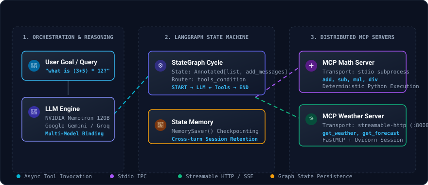
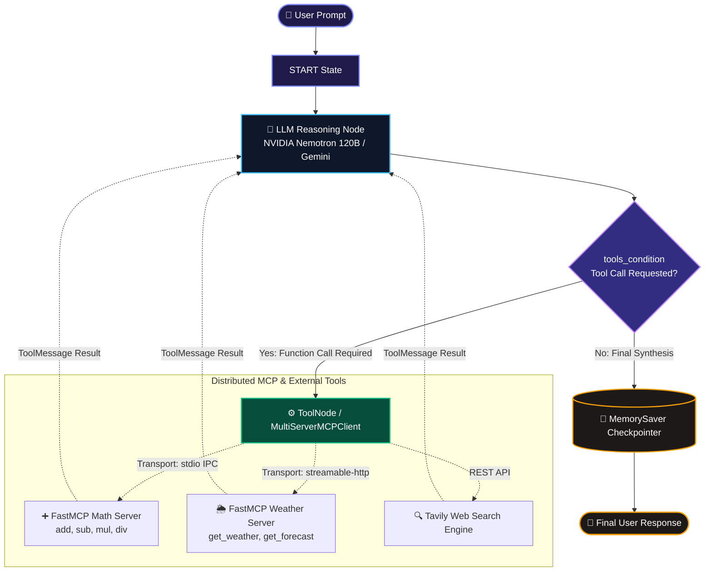

<div align="center">



<br/>

[](https://python.org)
[](https://langchain.com)
[](https://langchain-ai.github.io/langgraph/)
[](https://modelcontextprotocol.io)
[](https://build.nvidia.com)
[](https://www.trychroma.com/)
[](https://huggingface.co/sentence-transformers)
[](https://astral.sh/uv)

<p align="center">
  <b>A production-grade, stateful autonomous agent architecture combining LangChain 1.4+, LangGraph cyclic state machines, distributed multi-transport Model Context Protocol (MCP) microservices, and end-to-end Retrieval-Augmented Generation (RAG).</b>
</p>

[Explore Architecture](#-system-architecture) •
[Quickstart](#-quickstart--installation) •
[MCP Ecosystem](#-model-context-protocol-mcp-microservices) •
[RAG Pipeline](#-retrieval-augmented-generation-rag-pipeline) •
[Notebook Curriculum](#-educational-notebook-modules) •
[Troubleshooting](#-troubleshooting--faq)

---

</div>

## 📌 Executive Summary

**Agentic-AI** is an advanced open-source laboratory and reference framework for building **autonomous, tool-augmented, stateful reasoning systems**. Unlike standard prompt-and-response applications, this ecosystem demonstrates how modern LLMs can act as autonomous reasoning kernels capable of:

1. **Cyclic State Graph Execution**: Utilizing **LangGraph** to execute conditional reasoning loops, self-correction, dynamic tool dispatching, and state checkpointing.
2. **Distributed Microservice Tooling via MCP**: Connecting to isolated tools across multiple transport layers (**stdio IPC subprocesses** and **streamable HTTP / SSE web servers**) through Anthropic's **Model Context Protocol (FastMCP)**.
3. **Multi-Model Orchestration**: Interfacing seamlessly with state-of-the-art reasoning backends, including **NVIDIA Nemotron 120B**, **Google Gemini 3.8 Flash**, **OpenAI GPT-4**, and **Groq Llama 3**.
4. **Resilient Middleware & Enterprise Schemas**: Enforcing strict Pydantic structured output models, PII masking, safety guardrails, and conversation memory retention across long sessions.
5. **Production Retrieval-Augmented Generation (RAG)**: Ingesting multi-format unstructured documents (PDFs, text corpora), semantic chunking with metadata enrichment, generating dense embeddings via **SentenceTransformers**, persisting in **ChromaDB**, and executing normalized similarity retrieval for grounded LLM generation.

---

## 🏛 System Architecture

The ecosystem splits cognitive reasoning, graph orchestration, and tool execution into distinct, modular layers:

<div align="center">
  
</div>

### Execution Lifecycle Workflow



---

## 📂 Repository Structure

```plaintext
agentic-ai/
├── 📁 assets/                     # Animated SVGs, diagrams, and visual badges
│   ├── banner.svg                # Dynamic animated project banner
│   └── architecture.svg          # Real-time animated data-flow diagram
│
├── 📁 langchain/                  # Comprehensive LangChain 1.4+ Curriculum
│   ├── 1-langchain.ipynb         # Google Gemini integration & foundational setup
│   ├── 2-langchain.ipynb         # Unified multi-provider chat models (OpenAI, Groq, Google)
│   ├── 3-tools.ipynb             # Tool binding, validation & NVIDIA Nemotron execution
│   ├── 4-messages.ipynb          # HumanMessage, AIMessage, SystemMessage & multimodal payloads
│   ├── 5-structuredoutput.ipynb  # Schema validation & type safety with Pydantic
│   └── 6-middleware.ipynb        # Agent middleware: telemetry, PII masking, retries & guardrails
│
├── 📁 langgraph/                  # Stateful Cyclic Graph Workflows
│   └── 1-BasicChatbot.ipynb      # StateGraph, ToolNode, Tavily Web Search, & MemorySaver
│
├── 📁 mcp/                        # Model Context Protocol Microservices & Client
│   ├── client.py                 # MultiServerMCPClient orchestrating stdio & HTTP tools
│   ├── mathserver.py             # FastMCP stdio math server (add, sub, mul, div)
│   └── weather.py                # FastMCP streamable-http weather service on Uvicorn (:8000)
│
├── 📁 tr-rag/                     # Production Document Ingestion & RAG Subsystem
│   ├── 📁 data/                  # Multimodal corpus & vector persistence
│   │   ├── 📁 pdf/               # Source PDF corpus (MCP specs, offer letters, resumes)
│   │   ├── 📁 text_files/        # Text corpora & structured notes
│   │   └── 📁 vector_store/      # Persistent ChromaDB sqlite database & HNSW index
│   └── 📁 notebook/              # RAG Architectural Notebooks
│       ├── document.ipynb        # Ingestion pipeline: TextLoader, DirectoryLoader & metadata
│       └── pdf_loader.ipynb      # End-to-end RAG: PyPDF/PyMuPDF, Chunking, SentenceTransformers, ChromaDB & Retriever
│
├── 📁 src/agentic_ai/             # Project package source root
│   └── __init__.py               # CLI entrypoint definition
│
├── .env.example                  # Environment credentials template
├── pyproject.toml                # Project metadata & dependency declarations (uv build)
├── requirement.txt               # Pinned pip requirements backup
└── README.md                     # Complete project documentation
```

---

## ⚡ Quickstart & Installation

This project is built for ultra-fast, reproducible dependency management using **[uv](https://github.com/astral-sh/uv)**, while maintaining full compatibility with standard `pip`.

### 1. Clone the Repository
```bash
git clone https://github.com/Rudra130/agentic-ai.git
cd agentic-ai
```

### 2. Environment Setup

#### Option A: Using `uv` (Recommended — 10x-100x Faster)
```bash
# Create Python 3.12 virtual environment
uv venv

# Synchronize all pinned dependencies from uv.lock
uv sync
```

#### Option B: Standard Python `venv` + `pip`
```bash
python -m venv .venv

# Activate on Linux/macOS:
source .venv/bin/activate

# Activate on Windows (PowerShell):
.\.venv\Scripts\Activate.ps1

# Install requirements
pip install -r requirement.txt
```

### 3. Configure API Credentials
Create a `.env` file in the project root:

```ini
# NVIDIA NIM AI Endpoints (Used for Nemotron 120B reasoning)
NVIDIA_API_KEY=nvapi-your-nvidia-api-key

# Google Generative AI (Used for Gemini 3.8 Flash)
GOOGLE_API_KEY=AIzaSy-your-google-api-key

# Tavily Search API (Used for real-time web retrieval in LangGraph)
TAVILY_API_KEY=tvly-your-tavily-api-key

# Optional: Additional Providers
OPENAI_API_KEY=sk-your-openai-api-key
GROQ_API_KEY=gsk-your-groq-api-key
```

---

## 🧩 Model Context Protocol (MCP) Microservices

The repository demonstrates a **hybrid multi-transport MCP system**. The central client dynamically negotiates tools across two independent microservices:

| Server | Transport | Protocol / Host | Exposed Capabilities |
| :--- | :--- | :--- | :--- |
| **Math Server** (`mcp/mathserver.py`) | `stdio` | IPC Subprocess | `add(a, b)`, `sub(a, b)`, `mul(a, b)`, `div(a, b)` |
| **Weather Server** (`mcp/weather.py`) | `streamable-http` | HTTP / SSE (`http://127.0.0.1:8000/mcp`) | `get_weather(city)`, `get_forecast(city, days)` |

### Running the End-to-End MCP Pipeline

#### Step 1: Start the Weather MCP Microservice
Open your first terminal and start the Uvicorn-backed Streamable HTTP server:
```bash
uv run python mcp/weather.py
```
*Output:*
```text
INFO:     Started server process [18736]
INFO:     Waiting for application startup.
StreamableHTTP session manager started
INFO:     Application startup complete.
INFO:     Uvicorn running on http://127.0.0.1:8000 (Press CTRL+C to quit)
```

#### Step 2: Run the Multi-Server Agent Client
Open a second terminal to launch the autonomous ReAct agent:
```bash
uv run python mcp/client.py
```

*Live Execution Output:*
```text
1. Connecting to MCP servers and loading tools...
2. Connected! Loaded 6 tools: ['add', 'sub', 'mul', 'div', 'get_weather', 'get_forecast']

3. Asking agent: 'what's (3+5) * 12 ?' (executing multi-step tool calls, please wait ~20-30s)...
Processing request of type ListToolsRequest
Processing request of type CallToolRequest (add: a=3, b=5 -> 8)
Processing request of type CallToolRequest (mul: a=8, b=12 -> 96)

Agent Answer:
The result of (3 + 5) * 12 is **96**.

4. Asking agent: 'what's the weather in New York ?'...
Processing request of type CallToolRequest (get_weather: city="New York")

Agent Answer:
The current weather in New York is **25°C**.
```

---

## 📚 Educational Notebook Modules

The notebooks in this repository provide a progressive, hands-on masterclass in building modern agentic AI:

<details>
<summary><b>📖 Module 1: LangChain 1.4+ Foundations (<code>langchain/</code>)</b></summary>
<br/>

- **`1-langchain.ipynb`**: Introduction to LangChain 1.4 core abstractions. Authenticating Google Generative AI and streaming responses with `gemini-3.8-flash`.
- **`2-langchain.ipynb`**: Multi-provider interoperability. Using `init_chat_model()` to switch between OpenAI, Groq, and Google with identical code interfaces.
- **`3-tools.ipynb`**: Binding custom Python functions as first-class LLM tools using NVIDIA Nemotron 120B.
- **`4-messages.ipynb`**: The anatomy of conversational context. Managing `HumanMessage`, `AIMessage`, `SystemMessage`, `ToolMessage`, and multimodal image/document payloads.
- **`5-structuredoutput.ipynb`**: Production reliability with structured outputs. Enforcing strict Pydantic schemas, validation errors, and typed JSON responses.
- **`6-middleware.ipynb`**: Advanced agent middleware patterns: prompt interception, PII scrubbing, audit telemetry, token rate limits, and fallback retries.

</details>

<details>
<summary><b>🕸️ Module 2: LangGraph Stateful Chatbots (<code>langgraph/</code>)</b></summary>
<br/>

- **`1-BasicChatbot.ipynb`**:
  - Defining graph state using `TypedDict` and `Annotated[list, add_messages]`.
  - Creating cyclical loops (`START -> chatbot -> tools_condition -> ToolNode -> chatbot -> END`).
  - Real-time web retrieval integration with **Tavily Web Search**.
  - Combining search tools with custom calculation tools in a single unified graph.
  - Adding persistent cross-conversation memory with **`MemorySaver` checkpointer**.
  - Visualizing the compiled state graph directly with Mermaid PNG rendering (`draw_mermaid_png`).

</details>

<details>
<summary><b>🔍 Module 3: Production Retrieval-Augmented Generation (RAG) (<code>tr-rag/</code>)</b></summary>
<br/>

- **`document.ipynb`**:
  - Foundational data ingestion patterns with LangChain core.
  - Creating LangChain `Document` abstractions with custom metadata schemas (authors, dates, source tags).
  - Ingesting raw documentation with `TextLoader`.
  - Batch directory ingestion using `DirectoryLoader` with UTF-8 encoding and regex file globbing (`**/*.txt`, `**/*.pdf`).

- **`pdf_loader.ipynb`**:
  - Full end-to-end multi-PDF RAG pipeline.
  - Multi-document loading across diverse structures (resumes, offer letters, technical specifications) with `PyPDFLoader` & `PyMuPDFLoader`.
  - Semantic chunking with `RecursiveCharacterTextSplitter` (`chunk_size=1000`, `chunk_overlap=200`, hierarchical separators).
  - Building the `EmbeddingManager` wrapping HuggingFace `SentenceTransformer('all-MiniLM-L6-v2')` generating 384-dimensional dense vectors.
  - Designing the `VectorStore` class managing persistent ChromaDB collections (`chromadb.PersistentClient`).
  - Implementing the `RAGRetriever` with on-the-fly query embeddings, distance-to-similarity normalization, score thresholding, and top-k ranking.
  - Grounded question-answering and synthesis across retrieved document chunks.

</details>

---

## 🔍 Retrieval-Augmented Generation (RAG) Pipeline

The repository includes a dedicated **multimodal RAG subsystem (`tr-rag/`)** engineered for high-accuracy document ingestion, semantic chunking, dense vector indexing, and context-grounded LLM synthesis:

```mermaid
graph LR
    classDef ingestNode fill:#1e1b4b,stroke:#818cf8,stroke-width:2px,color:#fff;
    classDef chunkNode fill:#312e81,stroke:#c084fc,stroke-width:2px,color:#fff;
    classDef embedNode fill:#064e3b,stroke:#10b981,stroke-width:2px,color:#fff;
    classDef storeNode fill:#0f172a,stroke:#38bdf8,stroke-width:2px,color:#fff;
    classDef llmNode fill:#1c1917,stroke:#f59e0b,stroke-width:2px,color:#fff;

    Docs[📄 Unstructured Corpus<br/>PDFs & Text Files]:::ingestNode --> Loader[📥 Document Loaders<br/>PyMuPDF / PyPDF / TextLoader]:::ingestNode
    Loader --> Splitter[✂️ Recursive Splitter<br/>Chunk: 1000, Overlap: 200]:::chunkNode
    Splitter --> Embedder[⚡ SentenceTransformers<br/>all-MiniLM-L6-v2 384-d]:::embedNode
    Embedder --> VectorDB[(🗄️ ChromaDB Vector Store<br/>Persistent SQLite + HNSW)]:::storeNode
    
    UserQuery([🔎 User Query]):::ingestNode --> QueryEmbed[⚡ Query Embedding]:::embedNode
    QueryEmbed --> Retriever[🎯 RAGRetriever<br/>Normalized Similarity & Top-K]:::storeNode
    VectorDB -.-> Retriever
    Retriever --> ContextAug[📝 Augmented Prompt<br/>Query + Retrieved Chunks]:::chunkNode
    ContextAug --> LLM[🧠 LLM Reasoning & Answer<br/>Nemotron 120B / Gemini / GPT-4]:::llmNode
```



### Architectural Workflow

1. **Document Ingestion Layer**:
   - `PyMuPDFLoader` & `PyPDFLoader`: High-throughput PDF extraction capturing full text, page numbers, author, creation dates, and source file metadata.
   - `DirectoryLoader`: Automated recursive directory crawling with custom regex patterns (`**/*.pdf`, `**/*.txt`).

2. **Semantic Text Chunking**:
   - `RecursiveCharacterTextSplitter` divides documents into `chunk_size=1000` with `chunk_overlap=200`.
   - Respects natural paragraph and sentence boundaries using hierarchical delimiters: `["\n\n", "\n", " ", ""]`.

3. **Dense Vector Embeddings (`EmbeddingManager`)**:
   - Uses HuggingFace's **`all-MiniLM-L6-v2`** (`sentence-transformers`), mapping document text into compact, highly expressive 384-dimensional vector spaces.
   - Batch encodes with progress monitoring and returns optimized NumPy arrays.

4. **Persistent Vector Store (`VectorStore`)**:
   - Backed by **`chromadb.PersistentClient`**, persisting vector embeddings, chunk text, and metadata directly to disk (`tr-rag/data/vector_store/`).
   - Assigns unique document UUIDs (`doc_<uuid>_<index>`) and builds an HNSW index for ultra-fast nearest-neighbor lookups.

5. **Similarity Retrieval Engine (`RAGRetriever`)**:
   - Computes query embeddings in real time and queries ChromaDB for top-K matching records.
   - Accurately converts vector distance metrics to similarity scores (handling squared L2 distance: $\text{similarity} = 1.0 - \frac{\text{dist}}{2.0}$ and cosine distance: $\text{similarity} = 1.0 - \text{dist}$).
   - Filters results by `score_threshold` and ranks documents by similarity confidence.

6. **Context Augmentation & LLM Generation**:
   - Formats retrieved chunks into context windows, enabling LLMs (e.g. Gemini, Nemotron, or GPT-4) to answer queries with precise citations and zero hallucination.

---

## 🛠 Tech Stack & Core Libraries

| Technology | Role | Highlights |
| :--- | :--- | :--- |
| **LangChain Core** (`>=1.4.5`) | LLM Abstraction | Model abstraction, message protocols, structured schemas |
| **LangGraph** (`>=1.2.15`) | Cyclic Graph Engine | Stateful agent graphs, branch routing, conditional edges |
| **Model Context Protocol** (`>=1.30.0`) | Tool Microservices | Standardized RPC for AI tools via `stdio` & `streamable-http` |
| **ChromaDB** (`>=0.5.0`) | Vector Store | Persistent vector database, HNSW indexing, SQLite backend |
| **Sentence-Transformers** (`>=3.0.0`) | Dense Embeddings | `all-MiniLM-L6-v2` generating 384-dimensional vector representations |
| **PyMuPDF & PyPDF** | Document Ingestion | High-speed PDF parsing, text extraction, and metadata indexing |
| **FAISS** (`faiss-cpu`) | Vector Search | Highly optimized vector similarity search engine |
| **langchain-mcp-adapters** | Bridge Layer | Converts FastMCP tool catalogs into LangChain/LangGraph tools |
| **ChatNVIDIA** | Reasoning Engine | NVIDIA NIM integration for `nemotron-3.5-super-vl-120b-a12b` |
| **Tavily Search** | Web Retrieval | Real-time AI-optimized search engine with domain filtering |
| **Pydantic** (`>=2.10`) | Type Safety | Guaranteed schema compliance for LLM outputs |
| **Uvicorn & Starlette** | HTTP Server | High-performance ASGI runtime hosting the FastMCP weather server |
| **uv** | Package Manager | Fast virtualenv resolution, lockfile synchronization, and execution |

---

## ❓ Troubleshooting & FAQ

<details>
<summary><b>Q1: <code>FileNotFoundError: [WinError 2] The system cannot find the file specified</code></b></summary>
<br/>

**Cause:** In `mcp/client.py`, setting `"command": "python mathserver.py"` causes Windows `CreateProcess` to search for an executable named `python mathserver.py.exe`.  
**Fix:** Set `"command": sys.executable` and pass the script inside `"args": ["mcp/mathserver.py"]`. Using `sys.executable` guarantees that the child process uses the exact active virtual environment Python.
</details>

<details>
<summary><b>Q2: <code>ModuleNotFoundError: No module named 'mcp'</code></b></summary>
<br/>

**Cause:** The terminal defaulted to Anaconda's `base` Python or global Python instead of the `.venv` virtual environment where `mcp` was installed.  
**Fix:** Run scripts using `uv run python <script.py>` or activate your virtual environment with `source .venv/Scripts/activate` (followed by `hash -r` in Git Bash).
</details>

<details>
<summary><b>Q3: <code>[Errno 10048] error while attempting to bind on address ('127.0.0.1', 8000)</code></b></summary>
<br/>

**Cause:** An existing instance of `weather.py` is already running and listening on port 8000.  
**Fix:** Either continue using the already-running server, or terminate the existing process in your terminal using `Ctrl + C` (or kill the PID via Windows Task Manager / `taskkill /PID <pid> /F`).
</details>

---

## 👨‍💻 Author & Contributions

Created and maintained with ❤️ by **Rudra Tiwari**  
- **Email**: [rt1766285@gmail.com](mailto:rt1766285@gmail.com)  
- **GitHub**: [@Rudra130](https://github.com/Rudra130)

Contributions, feature requests, and issue reports are welcome! Feel free to open an issue or pull request.

---

<div align="center">
  <sub>Built with LangChain, LangGraph, Model Context Protocol, and NVIDIA NIM AI Endpoints.</sub>
</div>
